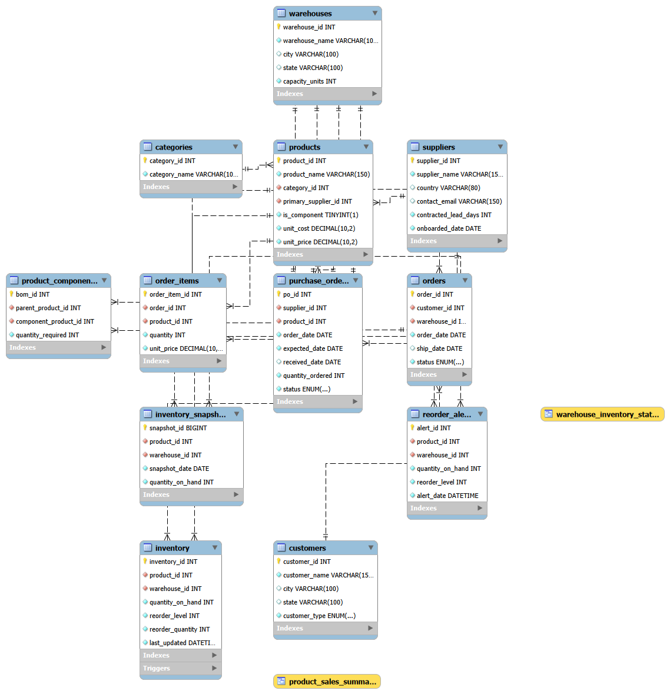
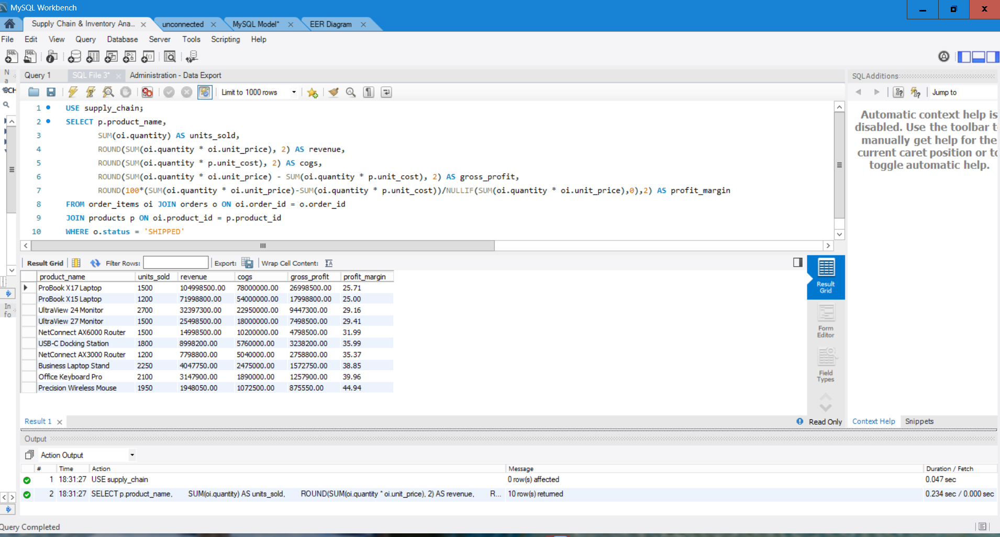
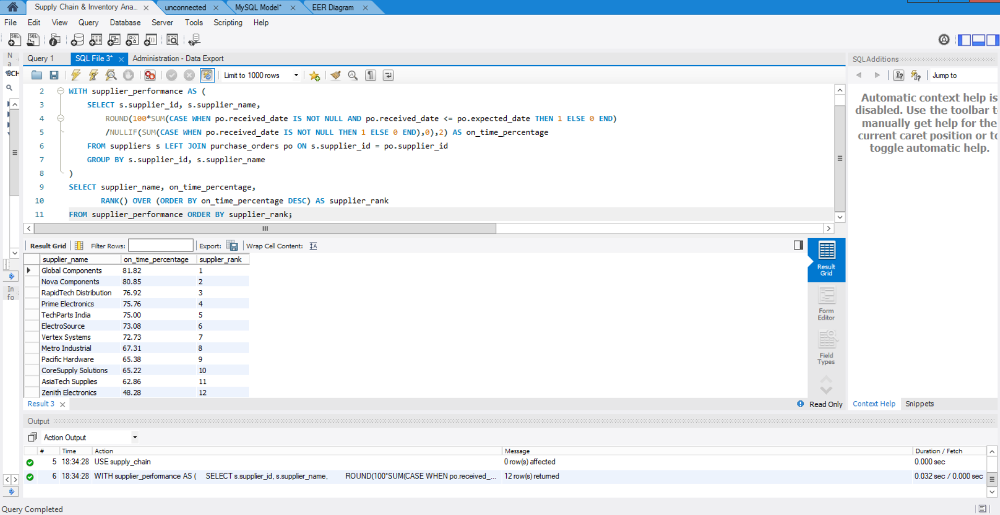
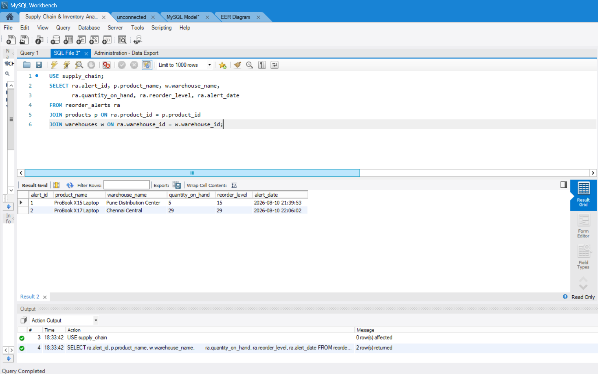
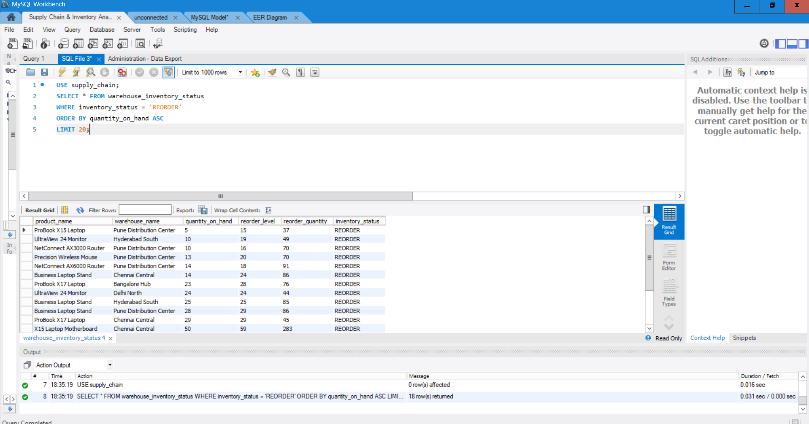

# SupplyChainIQ — Supply Chain & Inventory Analytics System

> A MySQL 8.0 database project demonstrating end-to-end supply chain data modelling, inventory management, procurement tracking, and business intelligence using advanced SQL.

---

## Project Overview

SupplyChainIQ is a relational database system designed to support supply chain operations for a technology hardware distributor. It tracks the complete flow of goods — from supplier procurement through warehouse inventory management to customer order fulfilment — and provides a suite of analytical SQL queries to answer key business questions.

The project demonstrates practical database engineering skills including schema design, referential integrity, trigger-based automation, analytical views, query optimisation, and advanced SQL techniques such as window functions and recursive CTEs.

---

## Business Problem

Supply chain teams need fast, reliable answers to operational and strategic questions:

- Which products are running low and need urgent reordering?
- Which suppliers consistently miss delivery deadlines?
- Which products generate the most profit?
- Which warehouses are slowest to fulfil customer orders?
- Which inventory is not moving and tying up capital?

This project builds the database infrastructure and analytical queries to answer these questions directly from the data.

---

## Technology Stack

| Component | Technology |
|---|---|
| Database Engine | MySQL 8.0+ |
| Storage Engine | InnoDB |
| Development Environment | MySQL Workbench 8.0 |
| SQL Standard | SQL:2003 (Window Functions, CTEs) |
| Character Set | utf8mb4 |

---

## Database Architecture

The database contains **12 tables** organised across four domains:

### Master Data
| Table | Description | Records |
|---|---|---:|
| `categories` | Product category classification | 10 |
| `suppliers` | Supplier master with lead times | 12 |
| `warehouses` | Warehouse locations and capacity | 6 |
| `products` | Product catalogue with cost and pricing | 40 |
| `product_components` | Bill of Materials (BOM) hierarchy | 31 |

### Inventory
| Table | Description | Records |
|---|---|---:|
| `inventory` | Current stock per product × warehouse | 240 |
| `inventory_snapshots` | 90-day daily inventory history | 21,600 |
| `reorder_alerts` | Auto-generated low-stock alerts | 2+ |

### Procurement
| Table | Description | Records |
|---|---|---:|
| `purchase_orders` | Orders placed with suppliers | 536 |

### Sales
| Table | Description | Records |
|---|---|---:|
| `customers` | Customer master (Retail + Wholesale) | 1,000 |
| `orders` | Customer sales orders | 3,000 |
| `order_items` | Order line items | 5,100 |

**Total records: ~31,575+**

---

## ER Diagram

> See [`diagrams/er_diagram.png`](diagrams/er_diagram.png) — export from MySQL Workbench EER Diagram view.

**Relationship summary:**

```
categories ──< products >── suppliers
                  │
         ┌────────┼────────────┐
         │        │            │
  product_     inventory    purchase_orders >── suppliers
  components  (current)
                  │
           inventory_snapshots

customers ──< orders >── warehouses
                │
           order_items >── products

inventory ──(trigger)──> reorder_alerts
```

---

## SQL Concepts Demonstrated

| Concept | Used In |
|---|---|
| Multi-table INNER JOIN | All analysis queries |
| LEFT JOIN | Supplier reliability, slow-moving inventory |
| GROUP BY / HAVING | Profitability, segmentation, fulfilment |
| Subqueries | Inventory coverage test |
| CTEs (Common Table Expressions) | Queries #3, #4, #5, #9 |
| Recursive CTE | Query #12 — BOM cost explosion |
| Window: `RANK()` | Query #3 — Supplier ranking |
| Window: `ROW_NUMBER()` | Query #5 — Top product per month |
| Window: `SUM() OVER()` | Query #4 — Running revenue total |
| Window: `AVG() OVER()` with ROWS | Query #6 — Rolling inventory average |
| Conditional aggregation `CASE/WHEN` | Queries #2, #7, #11 |
| `DATE_FORMAT()`, `DATEDIFF()` | Queries #4, #8 |
| `NULLIF()` for safe division | Queries #1, #2, #9 |
| `COALESCE()` for null handling | Query #9 |
| Views | `product_sales_summary`, `warehouse_inventory_status` |
| Triggers | `trg_inventory_low_stock` |
| Composite indexes | 6 indexes for query optimisation |
| EXPLAIN / query plans | `database/optimization/07_query_optimization.sql` |

---

## Analytical Queries

All 12 queries are in [`database/analytics/06_analysis.sql`](database/analytics/06_analysis.sql).

| # | Business Question | Key Technique |
|---|---|---|
| 1 | Product profitability — revenue, COGS, margin | Aggregation, NULLIF |
| 2 | Supplier on-time delivery percentage | Conditional aggregation |
| 3 | Supplier performance ranking | CTE + RANK() |
| 4 | Monthly revenue with running total | CTE + SUM() OVER() |
| 5 | Top-selling product each month | Multi-CTE + ROW_NUMBER() |
| 6 | 7-day rolling inventory average | AVG() OVER() with ROWS BETWEEN |
| 7 | Stockout days and percentage by product/warehouse | CASE/WHEN aggregation |
| 8 | Warehouse fulfilment speed (avg/min/max days) | DATEDIFF, MIN/MAX/AVG |
| 9 | Slow-moving inventory (inventory-to-sales ratio) | Multi-CTE, COALESCE |
| 10 | Products currently below reorder threshold | Filtered JOIN |
| 11 | Retail vs Wholesale customer segmentation | Multi-dimension GROUP BY |
| 12 | BOM total component cost for a finished product | **Recursive CTE** |

---

## Database Objects

### Views

| View | Purpose |
|---|---|
| `product_sales_summary` | Revenue, COGS, gross profit per product (SHIPPED orders) |
| `warehouse_inventory_status` | Stock levels with REORDER / SUFFICIENT flag per product × warehouse |

### Trigger

**`trg_inventory_low_stock`** — fires `AFTER UPDATE ON inventory`

- Inserts a row into `reorder_alerts` when stock transitions from above to at-or-below the reorder level
- Uses a crossing condition to prevent duplicate alerts on repeated updates

### Indexes (6 composite indexes)

| Index | Table | Columns |
|---|---|---|
| `idx_inventory_product_warehouse` | inventory | product_id, warehouse_id |
| `idx_inventory_snapshots_product_date` | inventory_snapshots | product_id, snapshot_date |
| `idx_purchase_orders_supplier_date` | purchase_orders | supplier_id, order_date |
| `idx_orders_customer_date` | orders | customer_id, order_date |
| `idx_orders_warehouse_date` | orders | warehouse_id, order_date |
| `idx_order_items_product` | order_items | product_id |

---

## Repository Structure

```text
SupplyChainIQ/
│
├── README.md
├── LICENSE
├── .gitignore
│
├── database/
│   ├── schema/
│   │   └── 01_schema.sql          ← Database and table definitions
│   ├── seed/
│   │   └── 02_seed_data.sql       ← Full dataset (mysqldump export)
│   ├── objects/
│   │   ├── 03_triggers.sql        ← Automated reorder alert trigger
│   │   └── 04_views.sql           ← Analytical views
│   ├── analytics/
│   │   └── 06_analysis.sql        ← 12 business analysis queries
│   └── optimization/
│       ├── 05_indexes.sql         ← Performance indexes
│       └── 07_query_optimization.sql ← EXPLAIN analysis
│
├── tests/
│   └── 08_validation_tests.sql    ← Integrity and correctness tests
│
├── docs/
│   ├── database_design.md         ← Schema design decisions
│   ├── business_questions.md      ← Query documentation
│   ├── data_dictionary.md         ← Full table and column reference
│   └── implementation_notes.md    ← Technical decisions and limitations
│
├── diagrams/
│   └── er_diagram.png             ← Entity Relationship Diagram
│
└── evidence/
    ├── screenshots/               ← MySQL Workbench screenshots
    └── query_results/             ← Exported query result samples
```

---

## Setup & Execution

### Requirements
- MySQL Server 8.0 or later
- MySQL Workbench 8.0 (recommended) or any MySQL client

### Step-by-Step Instructions

**Step 1 — Clone the repository**
```bash
git clone https://github.com/bhavini-verma/SupplyChainIQ.git
cd SupplyChainIQ
```

**Step 2 — Create the schema**

Open MySQL Workbench, connect to your local server, then run:
```
database/schema/01_schema.sql
```
This creates the `supply_chain` database with all 12 tables.

**Step 3 — Load the data**
```
database/seed/02_seed_data.sql
```
This loads the complete dataset (~31,500+ records across all tables).

**Step 4 — Create the trigger**
```
database/objects/03_triggers.sql
```

**Step 5 — Create the views**
```
database/objects/04_views.sql
```

**Step 6 — Create the indexes**
```
database/optimization/05_indexes.sql
```

**Step 7 — Run the analysis queries**
```
database/analytics/06_analysis.sql
```
Run queries individually in Workbench to see each business analysis result.

**Step 8 — Validate (optional)**
```
tests/08_validation_tests.sql
```
All tests should return expected results (0 orphans, 0 integrity violations).

> ⚠️ **Important:** `01_schema.sql` contains `DROP DATABASE IF EXISTS supply_chain`. Running it on an already-populated database will erase all data. If you only need to restore data, run `02_seed_data.sql` only.

---

## Evidence & Screenshots

All screenshots are genuine MySQL Workbench captures from the live `supply_chain` database.

### ER Diagram


### Product Profitability — Query #1
*Revenue, COGS, gross profit and margin per product across all SHIPPED orders*



### Supplier Ranking — Query #3 (Window Function: RANK())
*Suppliers ranked by on-time delivery percentage using `RANK() OVER()`*



### Automated Reorder Alerts — Trigger Evidence
*Rows auto-inserted by `trg_inventory_low_stock` when stock crossed below reorder threshold*



### Warehouse Inventory Status View
*`warehouse_inventory_status` view showing products currently in REORDER state*



---

## Limitations & Future Improvements

| Limitation | Suggested Improvement |
|---|---|
| Single product per purchase order | Add `purchase_order_items` table |
| No inventory movement log | Add `inventory_movements` audit table |
| No returns/refunds | Add `order_returns` table |
| No shipping carrier data | Add carrier and tracking fields to `orders` |
| No user/role tracking | Add `users` table with change audit log |
| Static snapshot loading | Automate daily snapshots via MySQL Event Scheduler |
| No dashboard | Connect to Tableau, Power BI, or Metabase for visual analytics |

---

## About This Project

**Domain:** Supply Chain Management, Inventory Analytics, Procurement, Business Intelligence  
**Database:** MySQL 8.0+  
**Tables:** 12 · **Records:** 31,575+ · **Queries:** 12 · **Views:** 2 · **Triggers:** 1 · **Indexes:** 6  

> Built to demonstrate practical database engineering — schema design, referential integrity, trigger-based automation, window functions, recursive CTEs, and query optimisation — using a realistic supply chain business domain.

